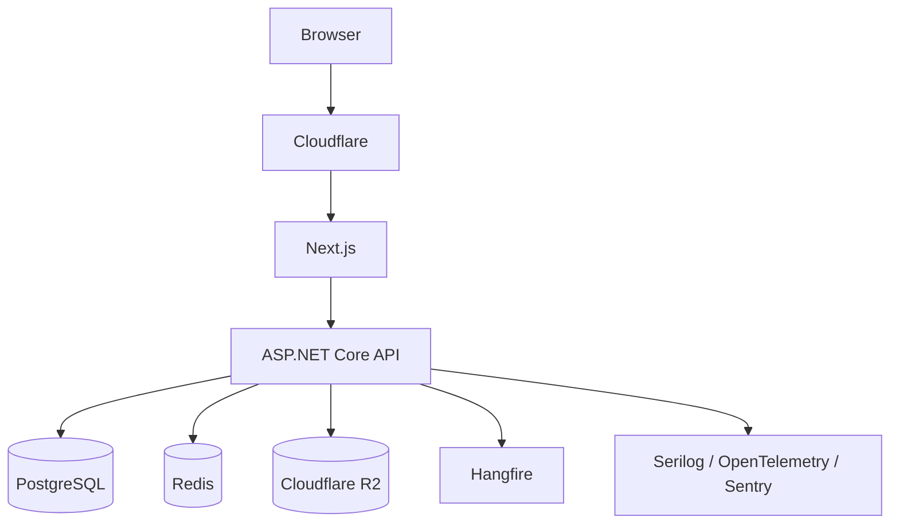

# NASH Architecture

## 1. Architecture Style

NASH uses a **Modular Monolith + Clean Architecture**.

The system is one deployable backend application, but business domains are separated into modules.

This gives:
- low operational complexity
- clear boundaries
- easy local development
- strong maintainability
- future extraction points if required

## 2. High-Level Architecture



## 3. Backend Layers

```text
NASH.Api
    ↓
NASH.Application
    ↓
NASH.Domain

NASH.Infrastructure
    ↑
NASH.Application
```

### Domain
Contains:
- entities
- value objects
- enums
- domain rules
- domain exceptions

Must not depend on infrastructure.

### Application
Contains:
- use cases
- commands/queries
- DTOs
- validation
- application interfaces
- authorization policies

### Infrastructure
Contains:
- EF Core
- PostgreSQL
- Identity implementation
- Redis
- R2
- Hangfire
- external integrations

### API
Contains:
- controllers/endpoints
- authentication setup
- middleware
- filters
- dependency injection
- OpenAPI configuration

## 4. Modules

Recommended modules:

```text
Auth
Users
Freelancers
Projects
Proposals
Contracts
Milestones
Reviews
Categories
Skills
Media
CMS
Reports
Admin
```

A module should own its application logic and persistence behavior as much as practical.

## 5. Request Flow

```text
HTTP Request
 → Middleware
 → Authentication
 → Authorization
 → Controller
 → Application Use Case
 → Domain Rules
 → Infrastructure
 → PostgreSQL / Redis / R2
 → DTO
 → HTTP Response
```

## 6. Stateless API

The API should be horizontally scalable.

Do not store request/session state in application memory unless explicitly designed as disposable cache.

## 7. Transactions

Use database transactions for multi-step business operations.

Example: accepting a proposal:

```text
BEGIN
  accept selected proposal
  reject competing proposals
  update project status
  create contract
COMMIT
```

If any required step fails, rollback.

## 8. API Error Contract

All predictable errors should use a consistent structure:

```json
{
  "statusCode": 400,
  "code": "PROJECT_INVALID_STATE",
  "message": "Project cannot be modified in its current state.",
  "requestId": "..."
}
```

Do not expose stack traces or internal exception details in production.
