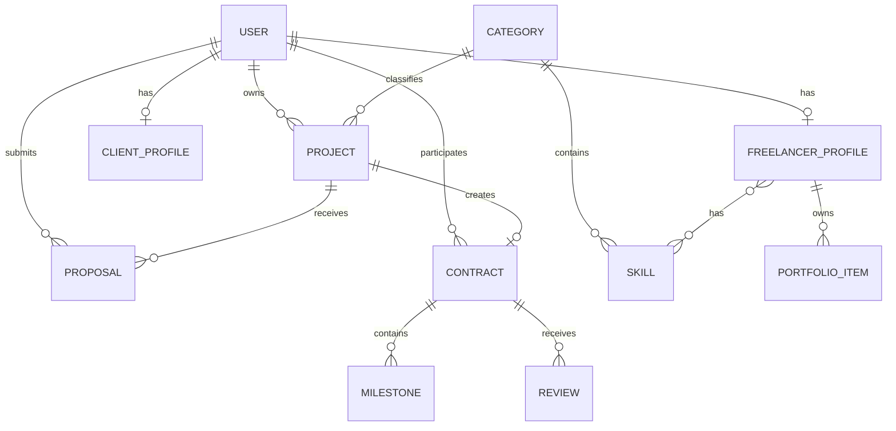

# NASH Domain Model

## Entities



## Core Entities

### User
Identity and account-level information.

Important fields:
- id
- email
- password hash / Identity credentials
- role
- status
- createdAt
- updatedAt

### FreelancerProfile
Public freelancer information.

### ClientProfile
Client-specific profile information.

### Project
Marketplace work request.

### Proposal
A freelancer's response to a project.

### Contract
Commercial/work agreement between client and freelancer.

### Milestone
A unit of work within a contract.

### Review
Feedback associated with a completed contract.

### Category
Project classification and CMS navigation.

### Skill
Reusable freelancer skill taxonomy.

### PortfolioItem
Freelancer showcase item.

### MediaAsset
Metadata for uploaded objects.

### CMSContent
Admin-managed public content.

### SEO Metadata
Title, description, canonical and social metadata associated with public resources.

## Domain Rules

1. A user may not act as another user's owner.
2. A freelancer cannot submit a proposal to their own project.
3. A freelancer can have at most one active proposal for a project.
4. Only the project owner can select a proposal.
5. Accepting a proposal creates exactly one contract.
6. A contract belongs to exactly one client and freelancer.
7. A contract must reference its originating project.
8. Project state transitions must be validated server-side.
9. Authorization must be checked server-side even if the UI hides actions.
10. Reviews must follow contract completion rules.

## State Transitions

### Project

```text
DRAFT → PUBLISHED
PUBLISHED → IN_PROGRESS
PUBLISHED → CLOSED
PUBLISHED → CANCELLED
IN_PROGRESS → COMPLETED
IN_PROGRESS → CANCELLED
```

### Proposal

```text
PENDING → ACCEPTED
PENDING → REJECTED
PENDING → WITHDRAWN
```

### Contract

```text
ACTIVE → COMPLETED
ACTIVE → CANCELLED
```

### Milestone

```text
PENDING → IN_PROGRESS
IN_PROGRESS → SUBMITTED
SUBMITTED → APPROVED
SUBMITTED → REJECTED
REJECTED → IN_PROGRESS
```

Invalid transitions must return a documented domain/application error.
